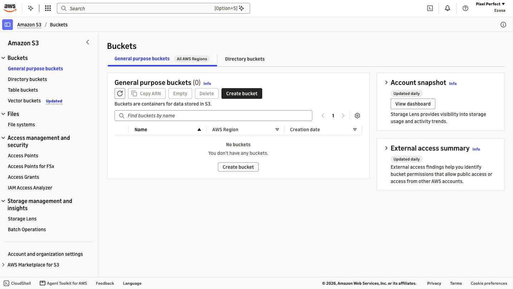
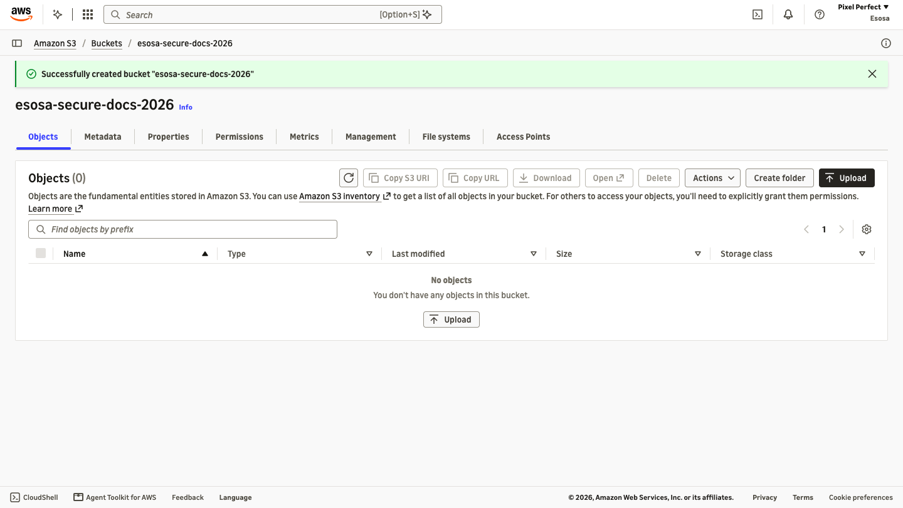
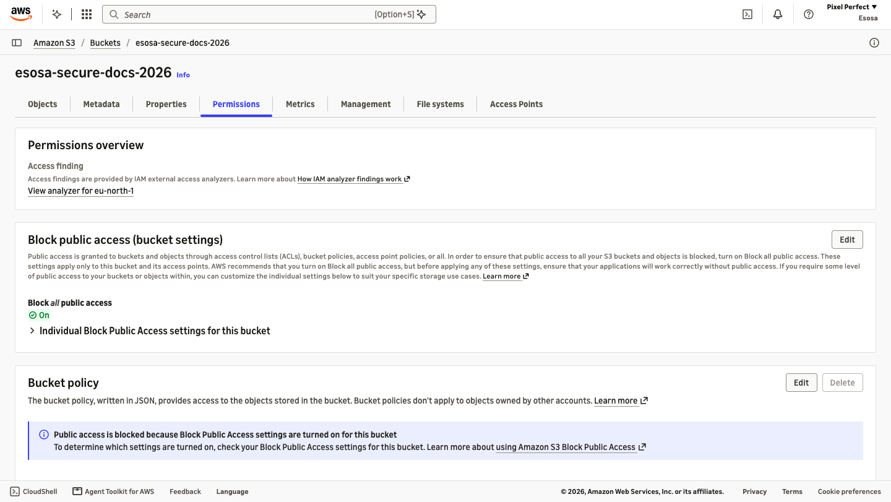
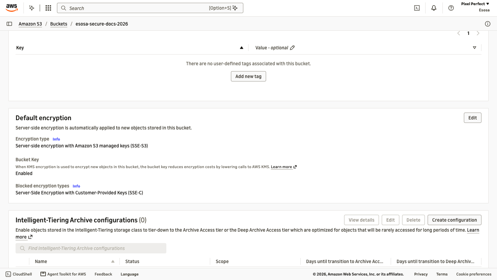
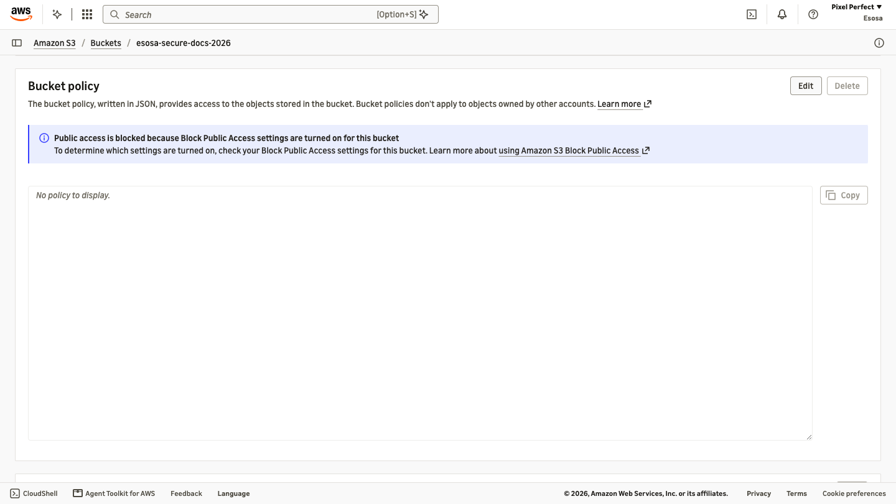
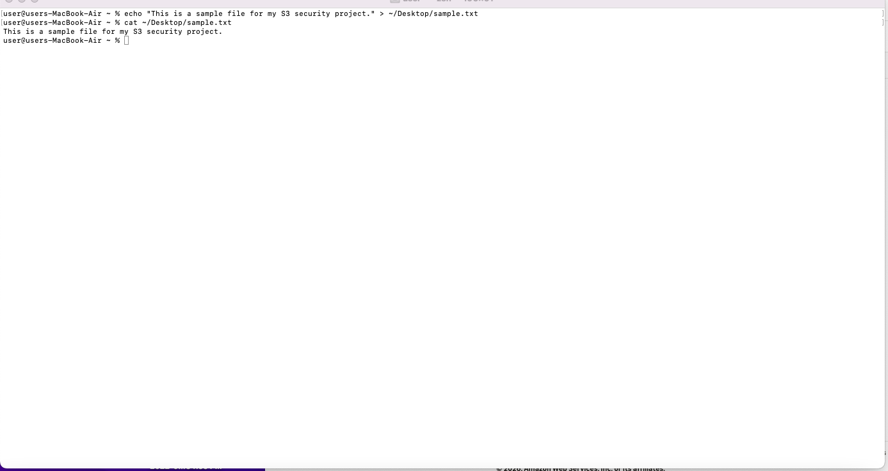
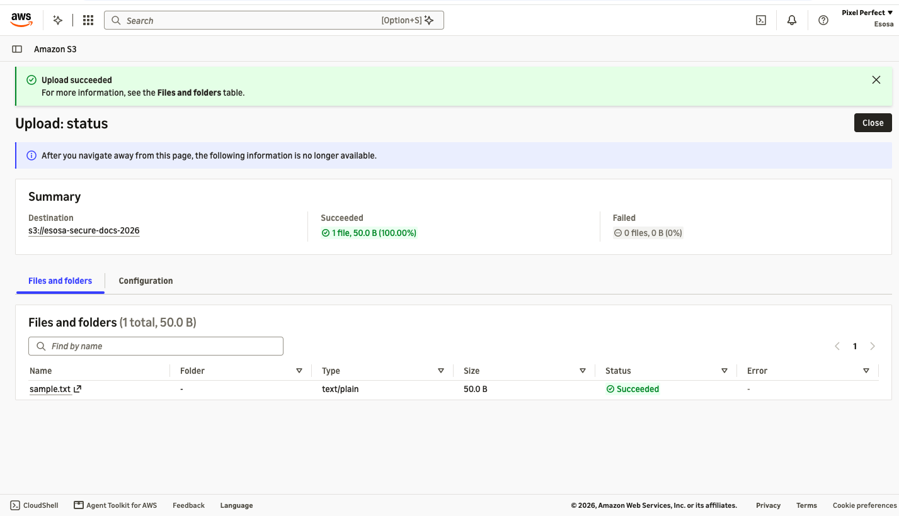
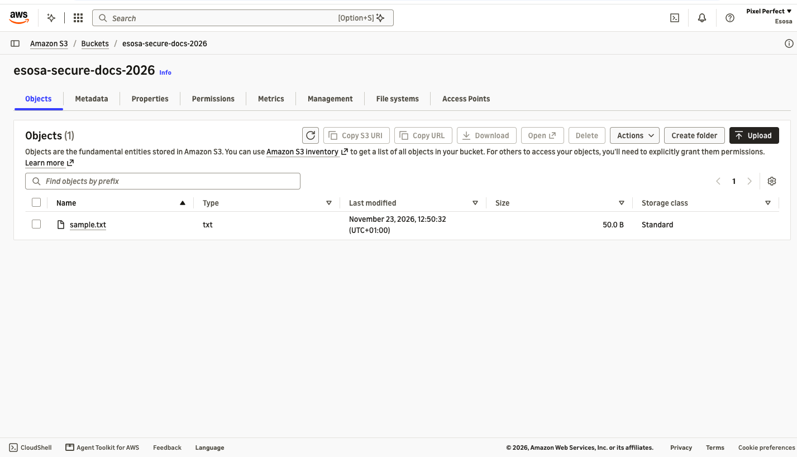
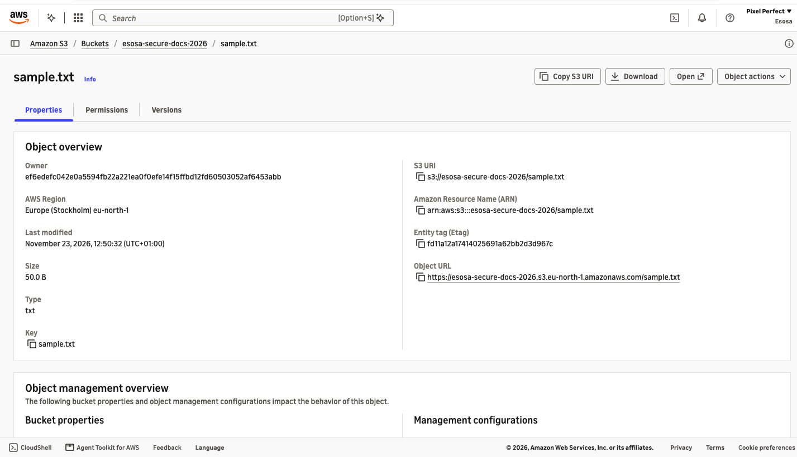
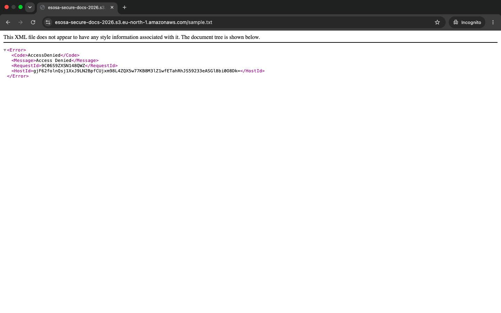

# Securing Cloud Storage Using AWS S3

**Level:** Beginner | **Platform:** Amazon Web Services (AWS) | **Region:** Europe (Stockholm) `eu-north-1`

## Objective

Create a private cloud storage environment on Amazon S3 and apply basic security controls to protect a company's files from unauthorised access.

## Tools Used

- AWS Management Console
- Amazon S3
- macOS Terminal (to create the sample file)
- Chrome Incognito window (to test public access)
- GitHub (documentation)

## Implementation Steps

1. **AWS account setup:** created an AWS account, logged in to the Management Console and located Amazon S3.
2. **Created the bucket:** `esosa-secure-docs-2026` in `eu-north-1`, with **Block all public access** left on.
3. **Reviewed security controls:** confirmed Block Public Access, checked default encryption and reviewed the bucket policy.
4. **Uploaded a file:** created `sample.txt` (dummy text only) and uploaded it to the bucket.
5. **Tested for public access:** opened the file's Object URL in an Incognito window, logged out of AWS.

## Security Controls Applied

| Control | Status |
|---|---|
| Block all public access | On |
| Default encryption | SSE-S3 (AES-256) |
| Bucket policy | None attached (no access granted beyond my own account) |
| Public access test | Passed: AccessDenied |

## Screenshots

**1. S3 console**

**2. Bucket created**

**3. Block Public Access: On**

**4. Default encryption: SSE-S3**

**5. Bucket policy: none attached**

**6. Sample file created in Terminal**

**7. Upload succeeded**

**8. File in the bucket**

**9. Object URL**

**10. Public access test: AccessDenied**

## Security Findings

- **Public access is blocked.** Opening the Object URL in Incognito, with no AWS login, returned `AccessDenied`.
- **Encryption is on by default.** New buckets use SSE-S3 automatically. I verified it instead of switching it on. SSE-C is also listed as a blocked encryption type.
- **No bucket policy was needed.** Block Public Access already prevented public access.
- **Versioning is disabled.** AWS recommends enabling it to protect against accidental deletion or overwriting. It was outside this project's scope.

## Security Analysis

**1. What is Amazon S3?**
AWS's cloud object storage service for storing and retrieving files over the internet.

**2. What is an S3 bucket?**
A container that holds files (objects) in S3. Its name must be unique across AWS.

**3. Why should public access be blocked?**
So only authorised people can reach the files. Otherwise anyone on the internet who finds the bucket could read or change the data.

**4. What is encryption, and why is it important?**
Encryption scrambles data so it can't be read without the key. If files are stolen, they are unreadable. Here, S3 encrypts the file at rest with SSE-S3.

**5. What could happen if a company accidentally exposes its S3 bucket?**
Data leaks, identity theft, fraud, fines, loss of customer trust and reputational damage. Attackers could also delete or alter files.

**6. What is the difference between authentication and authorisation?**
Authentication proves who you are (password, MFA). Authorisation decides what you are allowed to do (permissions, policies).

**7. Three ways to secure cloud storage**
- Keep Block Public Access on.
- Encrypt data at rest and in transit.
- Apply least-privilege access with IAM and bucket policies, plus MFA.

## Lessons Learned

- Block Public Access is on by default for new buckets, and it is the first line of defence.
- S3 now encrypts new objects by default, so the job is to verify encryption, not just turn it on.
- To test privacy properly, use the **Object URL** in an Incognito window. The console's **Open** button uses a temporary signed link, so it would show the file even when the bucket is private.
- A bucket policy adds extra rules, such as denying non-HTTPS access. Versioning and access logging are good next steps.

## Safety Note

Only a dummy sample file was used. No personal data, passwords, access keys or credentials are stored in this repository.
